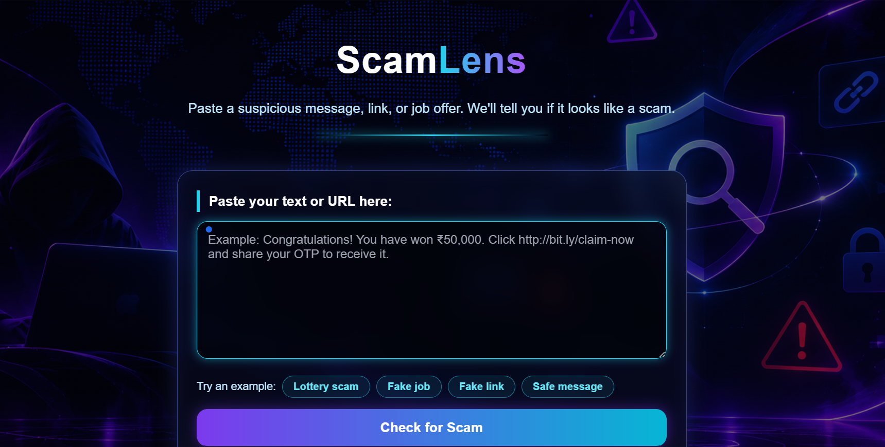
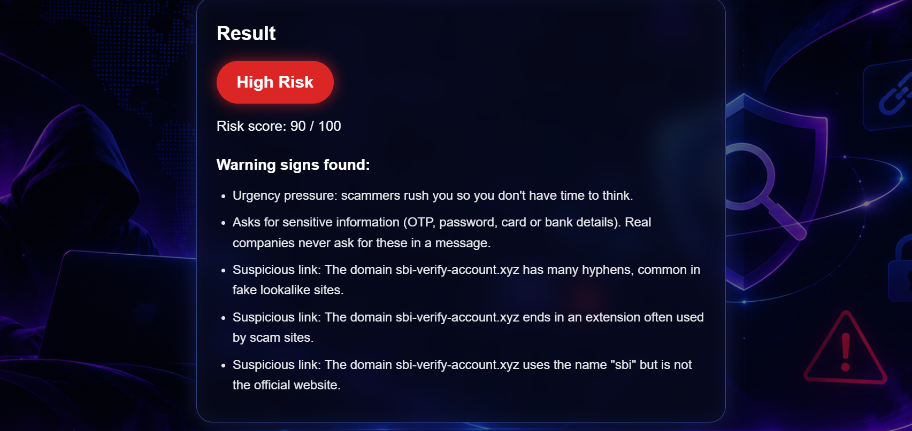
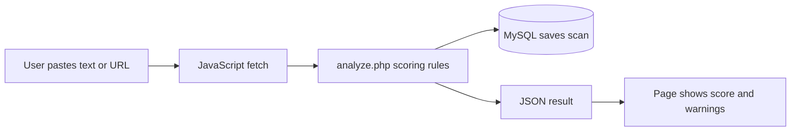

<div align="center">

#  ScamLens

### Paste it. Scan it. Stay safe.

A web tool that checks whether a **message, link, or job offer** is a scam,
gives a **risk score**, and explains the **warning signs** it found.


</div>

---

## 📸 Screenshots

| Home | Result |
|---|---|
|  |  |

---

## ✨ Features

- 🚨 **Scam pattern detection**: urgency pressure, OTP requests, upfront fees, too-good-to-be-true offers
- 🔗 **Link analysis**: raw IP addresses, URL shorteners, fake brand names, odd domain endings
- 📊 **Risk score out of 100** with Low / Medium / High levels
- 💡 **Explains why**: every warning sign is listed in plain language
- 🕑 **Recent scans** saved in a MySQL database
- ⚡ **One-click examples** to try it instantly
- 📱 **Responsive dark design** that works on phones

---

## 🧠 How it works



---

## 🎯 Scoring rules

| Warning sign | Example | Points |
|---|---|---|
| ⏰ Urgency pressure | "Act now", "account blocked" | +15 |
| 🔑 Asks for sensitive info | OTP, password, card number | +30 |
| 💸 Asks for money upfront | "registration fee", "deposit" | +25 |
| 🎁 Too good to be true | "You have won", "no experience" | +20 |
| 💬 WhatsApp / Telegram only | "Message me on Telegram" | +10 |
| 🔗 Suspicious link | `bit.ly`, IP address, fake brand | +15 each (max 45) |

**Risk levels:** 🟢 0-29 Low · 🟠 30-59 Medium · 🔴 60+ High

---

## 🛠️ Tools used

| Tool | Purpose |
|---|---|
| HTML, CSS | Page structure and design |
| JavaScript | Sends text to PHP and shows results |
| PHP | Scam rules and score calculation |
| MySQL, phpMyAdmin | Stores scan history |
| XAMPP | Local server |
| Git, GitHub | Version control |

---

## 🚀 Run it locally

1. Install **XAMPP** and start **Apache** and **MySQL**.
2. Copy this folder to `C:\xampp\htdocs\scamlens`.
3. In phpMyAdmin, create a database named `scamlens` and run `database.sql`.
4. Copy `db.example.php`, rename it to `db.php`, and check the database details.
5. Open `http://localhost/scamlens/`.

---

## 📁 Project structure

```
scamlens/
├── index.php        # Page layout
├── style.css        # Dark glass design
├── script.js        # Frontend logic
├── analyze.php      # Scoring engine
├── history.php      # Recent scans
├── db.example.php   # Database template
├── database.sql     # Table setup
└── Screenshots/     # README images
```

---

## 🔒 Security notes

- `db.php` is excluded from GitHub with `.gitignore`

---

## 🔮 Future scope

- Google Safe Browsing API for real URL checking
- User login and personal scan history
- "Report a scam" feature with an admin page
- Support for more languages (Hindi, Kannada)
- Machine learning based detection

---

## ⚠️ Disclaimer

This is a college project. Results are guidance only, not a guarantee.
If in doubt: don't click, don't pay, and don't share OTPs.


